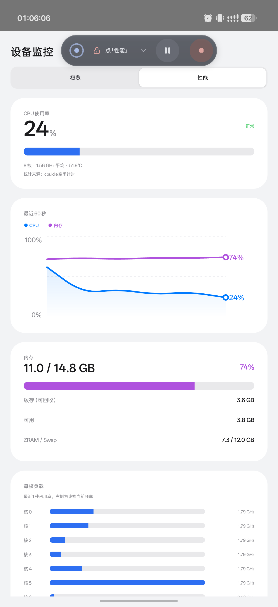
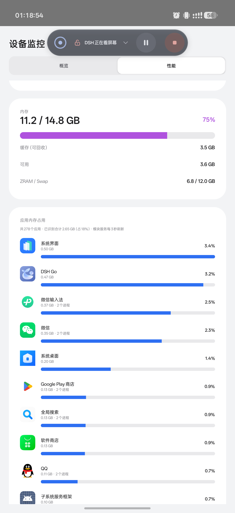

# 设备监控 SysMon

一个不依赖 Gradle、直接 `javac + d8 + apksigner` 打包的 Android 设备监控小工具，配套一个 KernelSU 模块做 root 侧的内存采集。

界面是纯 Java 手写 View，走 iOS 健康 App 的卡片风格：白卡、大号数字、圆角占用条、平滑曲线。

| 性能页（CPU / 内存） | 应用内存占用（root 模块数据） |
| --- | --- |
|  |  |

## 功能

**概览页**

- CPU 温度（多 thermal zone 取最高）、主板温度
- 电池温度 / 电量 / 充电状态
- 内存、各核频率、存储、运行时长
- 桌面小组件背景（色板 / 透明 / 自定义图片 + 遮罩），状态栏通知常驻

**性能页**

- **CPU 使用率**：大号百分比 + 状态标签（空闲 / 正常 / 繁忙 / 满载）+ 占用条 + 核心数 / 平均频率 / 温度 + 统计来源
- **最近 60 秒**：CPU（蓝）与内存（紫）双线曲线，1 秒一点，保留 120 点
- **内存**：已用 / 总量、占用条、缓存（可回收）、可用、ZRAM / Swap
- **应用内存占用**：Top 12 应用，图标 + 名称 + PSS 占用 + 占内存总量百分比 + 相对占用条
- **每核负载**：每个核心一条占用条 + 当前频率
- **系统**：平均频率、频率区间、CPU 温度、运行时长
- **负载记录**：今日 CPU / 内存曲线（前台服务每 5 分钟采样）

**电池页（原有）**：日 / 周 / 月电量与温度曲线、平均功耗、理论续航、各应用耗电估算。

## CPU 占用率怎么来的

Android 12 之后，应用进程读 `/proc/stat` 会被 SELinux 拒绝（`EACCES`），`/proc/loadavg`、`/proc/uptime`、`/proc/pressure/*` 同样读不到。所以 `Perf.java` 按可靠性依次降级：

| 优先级 | 数据源 | 说明 |
| --- | --- | --- |
| 1 | `/proc/stat` 前后差值 | 内核标准统计，原生机型可读时最准 |
| 2 | `cpuidle` 空闲计时 | 读 `/sys/devices/system/cpu/cpuN/cpuidle/stateX/time`，用 `1 - Δ空闲/Δ墙钟` 算占用；与 `/proc/stat` 同窗口实测差 <1% |
| 3 | 频率占比 | 每核 `scaling_cur_freq` 占 `cpuinfo_max_freq` 的比例，只作趋势兜底 |

性能页底部会写明当前实际用的是哪一条（例如「统计来源：cpuidle 空闲计时」）。

## 应用内存占用怎么来的

普通应用读不到别的进程，所以有两条路，`RootMem.java` 会自己选：

1. **模块模式（推荐，零授权）**：配套 KernelSU 模块的 `service.sh` 以 root 身份每 3 秒扫一遍 `/proc/<pid>/smaps_rollup`，把 `pid|Pss|cmdline` 写进本应用私有目录的 `root_mem.txt`（`chown` 给应用 uid）。App 只读自己的文件，**不会弹 su 授权，也不需要每次确认**。
2. **su 兜底**：没装模块时，App 自己 fork 一个 `su` 采样循环；`KernelSU` 把 `su` 藏起来时按名字解析会 `ENOENT`，所以会依次尝试 `/system/bin/su`、`/system/xbin/su`、`/sbin/su`、`/debug_ramdisk/su`。

PSS（Proportional Set Size）比 RSS 公允：共享库按比例摊到各进程，是 Android 自己 `dumpsys meminfo` 用的口径。

## 安装

### 方式一：模块 + App 一起（推荐，无需授权）

```bash
# 手机上：KernelSU Manager → 模块 → 从本地安装 → 选 zip → 重启
SysMon-内存模块-v1.1.zip
```

模块的 `customize.sh` 会把包内的 `app/sysmon.apk` 一并装好；重启后 `service.sh` 常驻采集，App 打开即用。

### 方式二：只装 App

直接用 APK 覆盖安装，性能页的「应用内存占用」会提示需要 Root，点「重新授权」触发一次 `su` 授权（KernelSU / Magisk 会弹窗）。拒绝授权时其余功能不受影响。

## 构建

不需要 Android Studio / Gradle，也不需要 aapt：资源与清单复用 `app/base-unsigned.apk`，只替换 `classes.dex` 再签名。

```bash
cd app
bash build.sh          # 产出 app-signed.apk
su -c 'cp app-signed.apk /data/local/tmp/ && pm install -r -d /data/local/tmp/app-signed.apk'
```

依赖：JDK 17、`android.jar`（API 34）、Android SDK build-tools 的 `d8` / `apksigner`、python3。

改资源或清单时才需要重新生成 `base-unsigned.apk`（apktool / aapt2 都可以）。

## 目录

```
app/                 应用工程（纯 Java，无 Gradle）
  src/com/dsh/sysmon/  MainActivity 页签与两个页面、Perf 采样、RootMem 应用内存、
                       UsageChartView / BarView 自绘、HistoryStore / PerfStore 记录
  res/ gen/           资源与 R.java
  base-unsigned.apk   资源 + 清单（没有 dex），构建时复用
  build.sh pack.py    构建脚本
module/              KernelSU 模块（service.sh 采集、customize.sh 装 App）
docs/                截图
```

## 说明

- `app/sysmon.jks` 是自用的开发签名（口令 `android`，别名 `sysmon`），只为让覆盖安装保留数据；正式分发请换成自己的密钥。
- 采集脚本只读 `/proc`、`/sys`，不联网、不上传任何数据。
